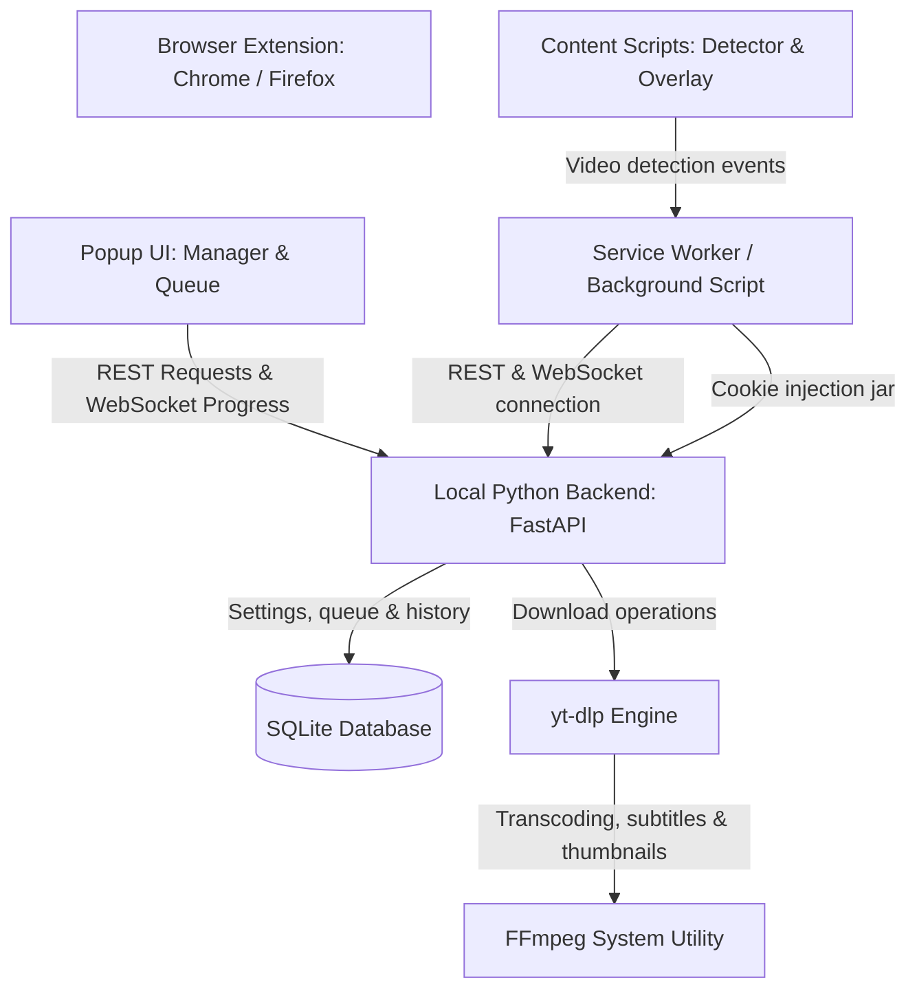

# 🎥 VidGrab — Cross-Browser Video Downloader & Queue Manager

VidGrab combines Google Chrome/Firefox extensions with a desktop companion for local media downloads. The app owns the queue, shared download defaults and bundled Python/yt-dlp/FFmpeg execution, so downloads can continue after the browser closes.

## Desktop companion development

The selected Linux/Windows desktop feasibility previews and scoped durable backend are implemented. Current source popup/options and desktop downloads/defaults use the generated native v1 contract; use a matching companion build. The 2026-11-16 migration passes selected Fedora/Ubuntu-userspace/Windows guarded/Chromium renderer/source/fresh-frozen checks; native GUI/installed-browser and final release acceptance remain open. See [current target validation](docs/DEVELOPMENT.md#p04-client-target-validation--2026-11-16), [browser connection guidance](docs/BROWSER_CONNECTION.md), [the plan](docs/PLAN.md) and [HANDOFF.md](HANDOFF.md). macOS follows the selected Linux/Windows targets.

The backend setup and endpoint examples below document retained legacy ASGI development. Current source clients use the native companion; per-request scheduling and arbitrary executable arguments are unavailable in that interface.

---

## 🏗️ Legacy backend architecture

VidGrab uses a hybrid architecture: a lightweight, responsive browser extension UI communicates via REST and WebSockets with a locally hosted background Python service.



---

## ✨ Features

- **Hybrid Video Detection**: Content scripts scan page DOMs dynamically and display a smooth, floating download button above active video elements.
- **Unified Download Manager**: Track active speeds, ETA, and progress bar updates in real-time via WebSocket streaming.
- **Power-User post-processing**: Change format containers (MP4/MKV/WebM), extract audios (MP3/FLAC/Opus), and normalize volume levels automatically.
- **SponsorBlock Integration**: Cut out sponsors, intros, outros, or self-promotions from YouTube videos automatically during download.
- **Cookie Jar Forwarding**: Securely forwards active browser cookies to download age-gated, private, or member-only videos.
- **Task Scheduler**: Schedule downloads to start automatically during off-peak hours (e.g. overnight).
- **Pinned Engine**: Uses a locked `yt-dlp` release; startup and status checks stay offline. Install a newer VidGrab release to update the engine.
- **Custom yt-dlp Flags**: Input custom CLI flags with warning verification and sanitization blocks to filter dangerous inputs.

---

## 🚀 Installation & Setup

Backend development requires Python 3.11+. For locked setup, isolated tests, runtime paths and explicit legacy-state import, see [docs/DEVELOPMENT.md](docs/DEVELOPMENT.md). The standalone desktop app is still planned; the commands below are the legacy extension/backend workflow. Keep the current unauthenticated backend bound to loopback only.

### 1. Run the Backend Installer

VidGrab provides automated install scripts to set up Python virtual environments, fetch dependencies, and register background processes.

#### 🐧 Linux & 🍎 macOS
Open your terminal and run:
```bash
bash installer/install.sh
```
*On Linux, this automatically configures and starts a user-level background systemd service (`vidgrab-backend.service`).*

#### 🪟 Windows
Open PowerShell as Administrator and run:
```powershell
Set-ExecutionPolicy Bypass -Scope Process -Force
.\installer\install.ps1
```
*This installs local dependencies and registers a Windows Task Scheduler task to launch the backend silently on startup.*

---

### 2. Load the Extension in Your Browser

Load `extension/` directly as the unpacked Chrome source. To produce browser archives:
```bash
bash build.sh
```
This replaces all of `dist/` with browser ZIPs; it leaves no unpacked browser folders. Do not run it when preserving locally modified archives.

#### Google Chrome / Chromium-based:
1. Open Chrome and go to `chrome://extensions/`.
2. Toggle **Developer mode** in the top right.
3. Click **Load unpacked** and select `extension/`.

#### Mozilla Firefox:
1. Open Firefox and enter `about:debugging` in the address bar.
2. Click **This Firefox** in the sidebar.
3. Click **Load Temporary Add-on...** and select `dist/vidgrab-firefox-extension.zip`.

---

## 🛠️ Diagnostics & Commands

If running the backend manually, execute uvicorn directly from the virtual environment:
```bash
cd VideoDownloadedExtension
./venv/bin/python -m uvicorn backend.main:app --host 127.0.0.1 --port 8000
```

### Systemd Service Logs (Linux):
```bash
# View live logs
journalctl --user -u vidgrab-backend.service -f

# Manage background service state
systemctl --user stop vidgrab-backend.service
systemctl --user start vidgrab-backend.service
systemctl --user restart vidgrab-backend.service
```

---

## 📝 License
VidGrab is open-source and released under the MIT License.
