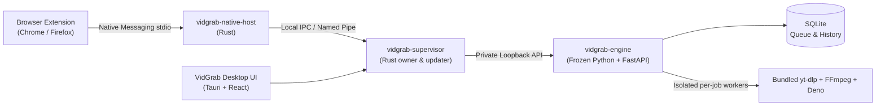

# VidGrab

[](https://github.com/azazarfin/VidGrab/actions/workflows/ci.yml)
[](https://github.com/azazarfin/VidGrab/releases/latest)
[](LICENSE)
[](https://github.com/azazarfin/VidGrab/releases/latest)

**VidGrab** is a standalone desktop media download manager and cross-browser companion for **Google Chrome** and **Mozilla Firefox**.

The desktop application owns the download queue, shared settings, and bundled `Python` / `yt-dlp` / `FFmpeg` / `Deno` runtime — so downloads continue reliably even after you close your browser, with no external Python or FFmpeg installation required.

---

## Architecture



- **Local-only execution:** No open public network ports; browsers talk to the desktop companion over OS-verified Native Messaging (`com.vidgrab.companion`).
- **Crash & exit resilience:** A Rust supervisor manages the frozen engine lifecycle, process-tree cleanup (POSIX groups / Windows Job Objects), durable SQLite state, and pre-update/pre-migration backups.
- **Zero system dependencies:** Desktop packages bundle `yt-dlp`, `yt-dlp-ejs`, `FFmpeg`/`ffprobe`, and `Deno` with checksum-pinned build inputs.

---

## Key Features

- **Standalone 5-Tab Desktop Manager:** Add single URLs or batches (multi-line paste or `.txt` import), inspect formats before downloading, manage active queues with priority/scheduling/pause/resume, search & filter history (non-destructive clear keeps files on disk), configure defaults, manage browser connections, and export redacted diagnostics.
- **Slim Cross-Browser Extension (Chrome & Firefox):** Floating on-page video detector overlay, format/quality picker modal, quick Queue & Recent controls, and one-click **Open in VidGrab** handoff.
- **Post-Processing & Format Control:** Container remux/transcoding (`MP4`, `MKV`, `WebM`), audio extraction (`MP3`, `FLAC`, `Opus`, etc.), audio normalization, subtitle embedding, thumbnail embedding, optional Bangla-to-Latin filename transliteration, and **SponsorBlock** integration.
- **Privacy-First Auth Contexts:** Optional, explicit browser permission grants with short-lived, volatile cookie jars cleaned up automatically after each download attempt.
- **Signed Updates & Automatic Rollback:** Engine updates are verified in pure Rust using RFC 8032 **Ed25519** signatures and SHA-256 checksums, snapshot active data before applying, and automatically roll back to the previous known-good bundle if health verification fails.

---

## Download & Install

Grab the latest installers and extension archives from [**GitHub Releases**](https://github.com/azazarfin/VidGrab/releases/latest):

| Platform / Target | Package | Notes |
| --- | --- | --- |
| **Linux (Fedora 40–43+ / RHEL / openSUSE x86_64)** | `VidGrab_<ver>-1.x86_64.rpm` | RPM package (`sudo dnf install ./VidGrab_*-1.x86_64.rpm`). Built on glibc 2.39 for broad Fedora/RHEL compatibility. |
| **Linux (Ubuntu 24.04+ / Debian x86_64)** | `VidGrab_<ver>_amd64.deb` | Debian package (`sudo apt install ./VidGrab_*.deb` or App Center). See [docs/LINUX_INSTALLATION.md](docs/LINUX_INSTALLATION.md). |
| **Linux (Portable x86_64)** | `VidGrab_<ver>_amd64.AppImage` | `chmod +x` and run directly, or install into your user Applications menu from inside the app. |
| **Windows (x64)** | `VidGrab_<ver>_x64-setup.exe` | Per-user NSIS installer (no administrator rights required). |
| **Google Chrome / Chromium** | `vidgrab-chrome-extension.zip` | Unzip and load via `chrome://extensions/` → **Developer mode** → **Load unpacked** (until store listing is live). |
| **Mozilla Firefox** | `vidgrab-firefox-extension.xpi` / `.zip` | Load via `about:debugging` → **This Firefox** → **Load Temporary Add-on…** (or install signed store build once listed). |
| **macOS** | *Planned (P08)* | Apple Silicon & Intel support is scheduled for a future milestone. |

> **Browser Connection Setup:** After installing the desktop app and extension, open **VidGrab → Browser** and click **Connect browsers**. For Firefox Snap/Flatpak portal setup or Chrome optional request-observation permissions, see [docs/BROWSER_CONNECTION.md](docs/BROWSER_CONNECTION.md).

### Verify Release Checksums

Every release ships a unified `SHA256SUMS.txt`:

```bash
# Linux / macOS
sha256sum --ignore-missing -c SHA256SUMS.txt

# Windows (PowerShell)
Get-FileHash .\VidGrab_0.1.0_x64-setup.exe -Algorithm SHA256
```

Update manifests (`vidgrab-update-manifest-linux-x86_64.json`, `vidgrab-update-manifest-windows-x64.json`) are signed with Ed25519 and verified automatically by VidGrab against its pinned public key (`6ee71cdd58c6f7bd787f9383eb0db61ed3157e0290ed1ed30370ab41b121561e`).

---

## Development & Building from Source

### Prerequisites

- **Python 3.11+** and [`uv`](https://docs.astral.sh/uv/)
- **Rust** stable toolchain (`cargo`, `rustc`)
- **Node.js 22+** and `npm`
- **Linux desktop builds:** `build-essential pkg-config libwebkit2gtk-4.1-dev libgtk-3-dev libayatana-appindicator3-dev librsvg2-dev libssl-dev patchelf squashfs-tools`

### Quick Start

```bash
# 1. Install locked Python & frontend dependencies
uv sync --locked
npm --prefix desktop ci --ignore-scripts

# 2. Verify generated protocol schemas (Python / Rust / TS / JS)
.venv/bin/python -m packages.protocol.generate --check

# 3. Run unit & contract test suites
.venv/bin/python -B -m unittest discover -s tests -p "test_*.py"
cargo test --locked -p vidgrab-supervisor -p vidgrab-native-host
node --test tests/check_*.mjs
npm --prefix desktop run build

# 4. Package Chrome & Firefox extensions non-destructively
.venv/bin/python packaging/package_extension.py --output packaging/out/extension
```

See [docs/DEVELOPMENT.md](docs/DEVELOPMENT.md) and [CONTRIBUTING.md](CONTRIBUTING.md) for full developer setup, frozen engine packaging (`packaging/stage_spike.py`), and opt-in VM/Playwright test suites.

---

## Migrating from the Legacy Backend

If you previously installed the older standalone Python service via `installer/install.sh`, `installer/install.ps1`, or `uvicorn backend.main:app`, follow [docs/MIGRATION.md](docs/MIGRATION.md) to:

1. Stop and disable the legacy `systemd` / Task Scheduler service.
2. Import compatible settings from `config.json` in **VidGrab → Settings → Migrate from legacy VidGrab service**.
3. Optionally import legacy SQLite download history without touching your existing media files.

---

## Documentation

| Document | Purpose |
| --- | --- |
| [docs/ARCHITECTURE.md](docs/ARCHITECTURE.md) | System design, process ownership, IPC, and protocol contract |
| [docs/BROWSER_CONNECTION.md](docs/BROWSER_CONNECTION.md) | Connecting Chrome, Firefox, Snap, and Flatpak browsers |
| [docs/LINUX_INSTALLATION.md](docs/LINUX_INSTALLATION.md) | Installing and cleanly removing Linux `.deb` and `AppImage` packages |
| [docs/MIGRATION.md](docs/MIGRATION.md) | Moving from the legacy backend to the packaged desktop companion |
| [docs/DEVELOPMENT.md](docs/DEVELOPMENT.md) | Locked setup, packaging pipeline, and opt-in integration tests |
| [docs/VALIDATION.md](docs/VALIDATION.md) | Platform release matrix and recorded verification evidence |
| [docs/PLAN.md](docs/PLAN.md) & [docs/DECISIONS.md](docs/DECISIONS.md) | Milestone roadmap (`P01`–`P08`) and architecture decision records |
| [CONTRIBUTING.md](CONTRIBUTING.md) | Contributor workflow, coding conventions, and PR checklist |
| [SECURITY.md](SECURITY.md) | Vulnerability reporting and security architecture |

---

## License & Third-Party Notices

VidGrab's own source code is licensed under the [MIT License](LICENSE).

Packaged desktop releases bundle third-party components (including **FFmpeg** under GPLv3, **yt-dlp**, **yt-dlp-ejs**, **Deno**, and bundled UI fonts). Full attributions and license texts are documented in [packaging/THIRD_PARTY.md](packaging/THIRD_PARTY.md) and shipped inside every release artifact.
