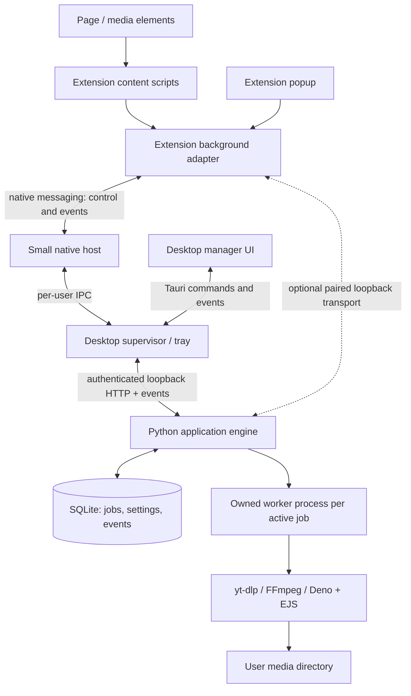

# Target architecture

Proposed design for the [plan](PLAN.md); paths and APIs in this document are future interfaces unless explicitly identified as current. User choices and recommendation status live in [DECISIONS.md](DECISIONS.md).

## 1. Application ownership



- The desktop supervisor is the single long-lived owner. Window close can hide to tray; explicit Quit stops workers cleanly and checkpoints state. Downloads are independent of the popup, browser service worker, and native-host connection lifetime.
- The native host is a small protocol bridge, not the downloader. Its browser-owned process can exit without killing the app. Launch the app through an OS-appropriate detached activation path; this requires specific Windows Job Object and POSIX process-group validation.
- The app starts one engine and holds its handle. A per-user single-instance lock prevents a second app/engine from claiming the same database. Engine loss causes bounded restart and state reconciliation, not an unlimited crash loop.
- The UI and extension never write SQLite or run download commands. Both use the same application services and versioned models. Closing a browser connection does not cancel its jobs.
- Optional start-at-login is controlled in the app. Users do not configure systemd or Task Scheduler manually. No always-on OS service is required for normal usage; a future headless mode can reuse the engine.

## 2. Components and migration boundaries

| Proposed location | Responsibility |
| --- | --- |
| `desktop/src/`, `desktop/src-tauri/` | TypeScript/React manager; Rust supervisor, tray, dialogs, activation, update/lifecycle integration |
| `native-host/` | Small Rust binary for framed browser messages and local supervisor IPC; shared Rust protocol helpers where useful |
| `backend/app.py`, `backend/runtime.py` | App factory and injected runtime configuration; retain `backend.main:app` as a development/legacy adapter during migration |
| `backend/api/`, `backend/services/` | Versioned routes, settings, queue/state machine, scheduling, event snapshots, admission and retry policy |
| `backend/engine/` | Process supervisor, worker entrypoint, extraction adapter, progress/output normalization, component capabilities |
| `backend/db/` | SQLite access, schema versions, migrations, artifact/job/event persistence |
| `extension/` | Existing source location; browser adapter, detection, scoped credentials, popup, browser-local preferences |
| `packages/protocol/` | Versioned schema snapshots and generated TS/JS clients; no platform globals in shared contracts |
| `packaging/` | PyInstaller spec/resources, native-host templates, component locks, installer definitions and notices |
| `tests/` | Unit and local integration fixtures, protocol compatibility and lifecycle checks |

Keep moves incremental and reviewable. Do not duplicate queue/business logic in Rust or the UI. The existing vanilla extension can consume a generated classic-script client; introducing the desktop frontend does not require rewriting all extension screens.

P01 implements `backend/app.py`, `backend/runtime.py`, `backend/db/` and isolated `tests/`; `backend.main:app` is an import-safe adapter. Runtime paths and process-local service state are injected. Legacy URLs remain unversioned: `/config`, `/probe`, `/downloads`, `/ws/progress`, `/health` and `/status`. `/update-ytdlp` returns 409. See [DEVELOPMENT.md](DEVELOPMENT.md) for commands.

The 2026-11-04 Linux P02 spike adds the Tauri connection window, `desktop/supervisor`, `native-host` and a frozen `backend.engine` service. This is a narrow feasibility implementation, while per-job worker processes, the full manager, installers and `/v1` remain proposed:

- One Rust owner holds a private `0700` IPC directory, `0600` lock/socket, and an engine process group. Same-user peer credentials are checked. Quit terminates and reaps that group before releasing ownership; engine crashes allow at most three restarts after the initial launch.
- The frozen engine receives a fresh credential over stdin, binds an ephemeral `127.0.0.1` port and reports authenticated readiness. Only authenticated `GET /health`, `GET /spike/status` and `POST /spike/fixture` are exposed. Host/Origin/body limits run before routing; legacy routes and WebSockets remain hidden. Python's audit guard blocks external connections in this fixture-only process.
- Native framing is UTF-8 JSON with a native-endian four-byte length and a 64 KiB spike limit. The envelope is `spike_version: 1`, `id`, `op`, `params`; browser operations are `status`, `activate`, `fixture.download`. Only a numeric loopback `/fixture.wav` URL is accepted. Local desktop IPC additionally permits Quit. This is not the P04 generated contract.
- Native-host activation starts a separate POSIX session after a status handshake. Browser mutations are forwarded once; a lost reply returns `REQUEST_OUTCOME_UNKNOWN`. Engine errors remain failures through the bridge. The desktop exposes three narrow commands and does not receive the engine token.
- PyInstaller's entire one-folder support tree is staged under `engine/`; the staged native host reads an explicit adjacent `host-config.json`. That selected staging layout determines frozen installation protection. Tauri resources include the support tree and target-suffixed native binary. The 2026-11-05 Linux preview now discovers engine resources through Tauri's resource resolver and the native sidecar beside the desktop executable; this passes against an extracted `.deb`.
- Packaged launch copies the native bridge to a private `XDG_DATA_HOME/vidgrab-p02/native` directory and writes per-user Chrome/Firefox manifests pointing there. Its `package_version: 1` descriptor retains the app launch target, state/media and fixed development browser identities. Engine paths are discovered on each desktop launch rather than persisted from a temporary mount. The native host selects `--package-config` for this descriptor and preserves `--config` for staged tests. Mutation forwarding and ownership remain unchanged.
- Chrome's stable development ID is `ikjpekhbbaehdhigakbahlhafaojbjpm`, and Firefox's is `vidgrab@azaz.local`. Firefox loads shared classic scripts explicitly. `vidGrabNative` is diagnostic transport; existing popup/options remain on `vidGrabAPI` until P04.
- The desktop crate defaults to `custom-protocol` for an embedded frontend in direct Cargo builds. The compiled window and installed native-browser handoffs have Linux fixture evidence in [VALIDATION.md](VALIDATION.md); package, tray/Wayland and Windows acceptance remain open. Returned filesystem paths pass unchanged through downloader/queue completion so existing Unicode directories remain addressable; metadata sanitization and broader artifact bookkeeping retain their existing boundaries.

The engine remains Python to retain yt-dlp integration. A frozen engine executable supports distinct service and worker entrypoints; worker startup must bypass server initialization. Start with PyInstaller one-folder packaging inside the application installer to avoid repeated extraction and make hidden dependencies inspectable. Bundle its support directory as resources; `externalBin` alone does not collect it.

## 3. Installation and lifecycle

1. Install one app with engine, Python runtime, FFmpeg/ffprobe, Deno, matching EJS components, and notices. Users need no Python, pip, Rust, Node, or shell commands.
2. First launch chooses the media directory and checks actual executable capabilities. Create user-owned runtime directories, then migrate a selected legacy database by copying it after backup.
3. Register native messaging for supported installed browsers using stable development/release extension IDs. Chrome uses `allowed_origins`; Firefox uses `allowed_extensions`. Registry and manifest paths are platform/browser-specific.
4. A browser request activates the app if needed, negotiates protocol/capabilities, and gets a queue snapshot. Missing app, missing registration, incompatible version, and denied permission are distinct UI states.
5. The supervisor waits for an authenticated ready message before enabling controls. Unexpected engine exit produces a recoverable status and bounded restart; no second engine is spawned against a still-live owner.
6. On Quit/update, stop accepting jobs, checkpoint active attempts, terminate and reap worker process trees, close the database, then exit/update. On next start, validate artifacts before requeueing interrupted jobs.

AppImage integration must point the browser host to a stable installed path, never a temporary mount. Moving/replacing the AppImage must repair registration. Flatpak/Snap browser host access is a capability to test, not assumed equivalent to native browser packages.

The Linux preview implements repair when the app is opened from its new location. A portable image's parent is a user directory, so registration protects the mounted package resources and binary directory without excluding normal media folders beneath the image's parent. Foreign manifests and symlink registration destinations are refused before publication. Browser disconnection removes only matching manifests and preserves the descriptor, copied bridge, state and media. The headless extracted-package check simulates relocation; separate native guest checks cover actual FUSE and package-manager lifecycle.

The Ubuntu preview now offers explicit per-user AppImage installation: copy the image, icon and checksum receipt into `XDG_DATA_HOME/vidgrab-p02/application` and publish an Applications shortcut. The launch descriptor selects this stable copy. Installation keeps the current engine session running. Removal verifies managed bytes, shortcut and ownership, refuses an active owner, disconnects browsers and deletes only managed application files. Selected state/media and the descriptor remain; disconnection survives reinstall. For `.deb`, the desktop verifies idle shutdown and hands removal to App Center, which owns OS authentication and package files. Native-only `quit_if_idle` requires an explicit false `downloads_active` across all unfinished database rows, independently of the latest 50 history items. Worker checkpointing and update recovery remain P03/P07.

## 4. Browser and API contract

### Primary transport

- Native messaging uses length-prefixed UTF-8 JSON; keep messages comfortably below the 1 MiB host-to-browser limit through pagination and event batches. Media bytes never pass through this channel. Stdout is protocol-only; logs go to stderr.
- The bridge uses a user-scoped Unix socket or Windows named pipe to reach the supervisor. The Rust side holds the engine's startup-generated credential and actual bound loopback port; bind on an available port instead of relying on 8000.
- The internal engine API validates its credential and Host/Origin policy. CORS is not authentication. The desktop webview gets narrow commands rather than arbitrary process execution or an exposed engine secret.
- Validate extension sender/tab/frame context and supported operation schemas at the background adapter. A content script may submit a media candidate, not set an arbitrary output path or run custom engine arguments.

### Optional fallback transport

For environments where native-host registration is unavailable, evaluate a manually enabled loopback connection. An app-generated one-time pairing code creates a revocable per-extension credential; never silently fall back to the current unauthenticated API. Allow only the paired extension origin and loopback host. Browser WebSockets cannot set arbitrary authorization headers: authenticate with a short-lived ticket or an initial auth frame with a deadline, and send no state before authentication. Keep credentials out of query strings and logs.

### Versioned operations

Proposed REST adapters under `/v1` and equivalent native-message operations:

| Operation | Contract |
| --- | --- |
| `GET /health` | Cheap local readiness; no PyPI or media-site requests |
| `GET /capabilities` | API compatibility range, engine/component versions, actual media/OS/browser capabilities |
| `POST /probes` | Candidate + scoped auth-context reference; returns probe ID/results or a typed failure; duplicate in-flight requests share work |
| `POST /downloads` | Request ID + idempotency key + candidate/options; transactionally returns the same job for repeated identical submissions |
| `GET /downloads` | Filtered/paginated jobs and aggregate counts; no unbounded history fetch for a badge |
| `POST /downloads/{id}/actions` | Validated retry/pause/resume/cancel commands with explicit current-state results |
| `GET/PATCH /settings` | Partial updates with a settings revision; stale revisions receive a conflict and current revision |
| `events.subscribe` / `WS /events` | Server instance, cursor, snapshot, task revisions and coalesced progress; gap requires resnapshot |

Use stable error fields: `code`, `message`, `retryable`, `retry_at`, `request_id`, and actionable details. Examples: `AUTH_REQUIRED`, `RATE_LIMITED`, `FORMAT_EXPIRED`, `UNSUPPORTED_MEDIA`, `DISK_FULL`, `COMPONENT_MISSING`, `APP_INCOMPATIBLE`. An upstream HTTP failure and a local admission-limit response must have distinct provenance.

Pydantic models are the service contract source; generate checked-in versioned schema/client outputs without starting the app. Native transport wraps the same models. Each client handshake advertises supported protocol versions; the installer and extension releases declare their compatibility range. A staged legacy adapter may exist during migration, but the packaged app must not expose unrestricted old endpoints.

## 5. Media discovery and request reliability

### Discovery ladder

1. Prefer the canonical page URL with a maintained yt-dlp extractor.
2. Gather direct `<video>`, `<audio>`, `<source>`, relevant links, and page metadata; rescan on SPA/frame changes without probing each DOM mutation.
3. With browser permissions, observe request URL/content type and manifest hints for generic direct media, HLS, and DASH. Do not assume request observation provides response bodies, decryptable segments, or a reconstructable MediaSource stream.
4. Present deduplicated candidates with their source and confidence; probe only user-selected candidates or a bounded active-tab selection.

Capture page URL, frame URL, original media URL, referer/user-agent where needed, and an expiring browser auth context. Keep URL query parameters intact: many are signatures. Authenticated probe cache keys include context identity/revision; never share results across browser profiles. `blob:` URLs require a page/extractor/manifest fallback. Report unsupported protected or browser-only streams explicitly.

Probe and download use the same context. Cookie forwarding remains opt-in and browser-scoped; no hardcoded profile paths. Keep cookies in a volatile credential store and temporary worker-owned files, with cleanup after process exit. After app restart, jobs needing expired credentials enter `waiting_for_auth`; obtain fresh context rather than storing raw cookies in job JSON. Redact signed URLs and credential headers from diagnostics.

### Request budgeting

Use one coordinator for probes, active media jobs, fragment concurrency, and automatic retries. Initial conservative defaults to validate: two active jobs globally, one per host, two probes globally with one per host, and two fragment connections per job. Persist due times rather than spinning in retry loops.

- Coalesce identical in-flight probes; bound successful-result caches by both size and TTL. Do not cache authentication or rate-limit failures as successful media results.
- Apply a finite total attempt budget. Configure inner yt-dlp retries so they cannot multiply an outer retry loop unexpectedly. Respect upstream `Retry-After` completely; jittered exponential backoff applies when no deadline is supplied.
- A 429 cools down the affected host and reduces pressure; connectivity/5xx failures can retry within budget. Do not automatically retry every error.
- An expired signed URL/format may re-probe once with fresh browser context. Authentication failures need a user action; do not keep retrying 401/403 unchanged.
- Preserve chosen quality/container intent when falling back. Prefer remuxing over re-encoding; do not always force YouTube HLS or an NVIDIA encoder. Detect available encoders by a real capability check and keep a CPU path.
- Coalesce progress to at most a few updates per second per active job; flush terminal transitions immediately. Push aggregate counts instead of re-fetching the queue for every event.

Record extractor, host, phase, status, attempts, elapsed time, request ID and selected engine version. Diagnose actual rejection responses with this data before attributing them to a specific source. The user's earlier agent-API rejection report is not evidence of a VidGrab backend rate-limit cause.

## 6. Job persistence, cancellation, and artifacts

Core state progression:

```text
scheduled -> queued -> probing -> downloading -> postprocessing -> completed
                         |              |               |
                         +------> retry_wait ------------+ -> queued (when due)
                         +------> waiting_for_auth --------> queued (fresh context)
active/queued ----------> paused | cancelled | failed
```

Define allowed transitions in one state-machine service. Job records carry revision, attempt count, next-attempt time, source/options, ownership and recovery metadata. Playlist items are child jobs; completed children remain complete if another item fails.

- SQLite is the durable authority. Use transactions for job claims and state/event persistence, bounded write contention handling, explicit migrations, and a single engine owner. In-memory progress is a view, not the only source of reconnect state.
- Give every attempt an owned worker process and artifact directory. Cancellation requests cooperative stop, then terminates/kills the whole owned process tree after a bounded grace period. Wait for exit before deleting cookies or emitting final cancellation.
- Resume compatible direct/fragment downloads from verified partial artifacts. If source validators change or the format cannot resume, explain restart semantics. Post-processing pause may require restarting that phase; do not present it as guaranteed byte-accurate pause.
- Final paths come from completed post-processing output records. Validate expected outputs before marking complete; support multiple playlist/subtitle/thumbnail outputs. Avoid filename-prefix globs that could remove another job's files.
- Preserve original display metadata independently from filename policy. Apply platform-safe filename rules and collision handling before writing. Never transliterate/normalize a returned full path and assume the renamed file exists. Carry the current sanitizer forward until its intended user behavior is clarified.

Suggested persistence groups: jobs/attempts, output artifacts, settings with revision, schema migrations, pairing records, and bounded event history. Raw cookies are excluded. The precise schema is a P01/P03 implementation deliverable, not frozen by this sketch.

The current P03 WIP implements a private owner and worker per ordinary download attempt. The engine owns the control pipe; control EOF requests teardown. Linux owners adopt/reap the process group, and Windows owners hold a non-inheritable kill-on-close Job Object. Bounded newline JSON is validated before progress/results cross the boundary. Repeated caller cancellation stays joined until the owned task/tree exits; queue terminal writes compare expected states under per-job locks, and cookie cleanup follows exit. Explicitly injected synchronous diagnostic/test runners retain a joined thread adapter.

Source/fresh frozen worker and native compatibility checks now pass on Linux and Windows; [the current checkpoint](../HANDOFF.md#p03-windows-workerprotocol-checkpoint--2026-11-14) scopes that evidence. Existing download rows and transient ownership do not implement the durable attempts/artifact/retry schema above. Full service crash recovery and P03 acceptance remain unfinished.

## 7. Settings and desktop UX

The app owns download preferences and desired companion preferences. The extension owns browser-granted permissions, profile/tab state, and live credentials. A preference such as cookie forwarding can be requested from the app, but the browser must obtain permission; show requested versus effective capability.

- Queue/history and format defaults use one settings model. Partial updates preserve unspecified fields; optimistic revisions resolve two-client edits. Browser-local offline edits are pending changes, not an independent authoritative config.
- Desktop screens: queue, Add URL/batch, history, download settings, browser integration, and diagnostics/components. The extension focuses on current-page media and quick actions.
- The app must work when no browser is open. Provide reveal-folder/open-file through platform adapters, directory selection, disk-space failures, tray/login controls, and clear offline/recovery states.
- Schedule only while the app is running or started at login; do not promise waking a sleeping machine. Reconcile due jobs on resume using persisted UTC deadlines.

## 8. Packaging, updates, and platform targets

| Target | Initial artifact | Important validation |
| --- | --- | --- |
| Linux x86_64 | AppImage and `.deb` | Chosen glibc/WebKitGTK baseline, X11/Wayland, tray absent, FFmpeg/Deno launch, native-host path stability |
| Windows x64 | Per-user NSIS installer | WebView2 provisioning, paths with spaces/non-ASCII, antivirus behavior, Job Objects, HKCU host registration |
| macOS later | `.app`/DMG for validated architectures | WKWebView, app relocation, embedded binary signing, notarization, native-host locations |

OS/webview dependencies still exist even with bundled Python; the installer must handle or clearly detect them. Exact minimum versions are determined by P02/P08. Native Chrome/Firefox are the initial browser validation targets; Edge/Brave and sandboxed distributions need explicit integration results before being listed as supported.

Build Python bundles on each target OS/architecture; PyInstaller is not a cross-compiler. Tauri external binaries require the target-triple filename suffix. Lock Python/npm/Cargo dependencies and component checksums in CI; verify packaged paths and dynamic yt-dlp imports with actual fixture downloads.

The app update service owns updates. For the first release, ship tested engine/component bundles with app updates; a later independently versioned engine bundle may use the same signed-manifest/rollback mechanism. Do not run pip or download arbitrary code during engine startup or probes. Bundle matching EJS components instead of depending on runtime remote fetches. Retain the previous known-good version, delay activation until jobs are checkpointed, and pair schema migrations with a data backup/compatibility check.

Publish signatures/checksums and notices for the exact FFmpeg, yt-dlp and related builds; their redistribution licenses depend on included components. Public release identity/hosting is a P07 decision. Update availability must never block basic offline queue/settings use.

## 9. Current-code evidence driving this design

| Verified current behavior | Planned response |
| --- | --- |
| `downloader.py` sets `noresume=True`, assumes an output extension, and hardcodes `h264_nvenc` for GPU MP4 | Artifact/resume tracking; actual capability detection; authoritative output records |
| `queue_manager.py` cancels an asyncio wrapper around `to_thread`, then cleans up state/files in `finally` | Owned process termination/reaping before cleanup |
| Automatic failures requeue immediately with no deadline/backoff | Typed failures, persisted retry schedule and shared request budget |
| `format_probe.py` accepts only a URL; caches by URL; starts independent threads for misses | Shared auth context, bounded/coalesced probes and context-aware cache |
| Baseline `main.py` updated through pip at startup and `/status` contacted PyPI | P01 implements local health/status and disables runtime updates; signed component updates remain P07 |
| Baseline settings lived beside source and PATCH wrote all defaults | P01 implements injected paths, migrations and partial updates; settings revisions remain P04 |
| Browser quick-download defaults in storage can diverge from backend settings | One authoritative settings model and explicit browser-local fields |
| Firefox manifest uses background scripts while shared code assumes `importScripts` and `chrome.alarms`; Firefox lacks `alarms` permission | Browser-specific bootstrap and permission/lifecycle tests in P02 |
| `test_gpu.py` imports a missing module; the sanity script is network-dependent | Controlled integration fixtures and capability tests |

These are implementation observations, not a measured explanation for every download failure.

## References consulted

Official sources checked during planning on 2026-11-03; pin and recheck concrete versions at implementation time.

- [Tauri sidecars](https://v2.tauri.app/develop/sidecar/): bundled Python servers and target-triple naming.
- [Tauri distribution](https://v2.tauri.app/distribute/): platform installer formats and signing integration.
- [PyInstaller operating model](https://pyinstaller.org/en/stable/operating-mode.html): OS-specific builds, one-folder resources, hidden imports.
- [Chrome native messaging](https://developer.chrome.com/docs/extensions/develop/concepts/native-messaging): registration, framing, origin allowlist, message limits.
- [Firefox native messaging](https://developer.mozilla.org/en-US/docs/Mozilla/Add-ons/WebExtensions/Native_messaging): manifest/argument differences and browser-owned process lifetime.
- [yt-dlp dependencies](https://github.com/yt-dlp/yt-dlp#dependencies): Python baseline, FFmpeg/ffprobe, EJS/runtime support and build-specific licenses.

## P02 Windows native implementation checkpoint

The native owner now builds on Windows x64. It uses a SID-restricted named pipe with remote-client rejection and kernel-verified same-account peers plus an exclusive owner file lock. Selected filesystem destinations reject reparse points. Engines start suspended, enter a non-inheritable kill-on-close Job Object, then resume; descendant teardown survives abrupt owner death. Detached app activation and engine creation use CreateProcessW/STARTUPINFOEXW with explicit handle whitelists to prevent inheriting browser pipes or the owner Job handle.

Windows package descriptors retain the Linux package_version 1 contract and separate state/media. Private bridge manifests are published through both HKCU native-host registry views for Chrome and Firefox. Foreign values/links block publication; disconnect persists revocation before removing owned keys/files. Native stdio remains bounded framed JSON and lost mutations are never replayed automatically. Actual frozen native checks pass; Tauri desktop, browser and standard-user installer acceptance are the next P02 gates. Worker processes and /v1 remain later work.
